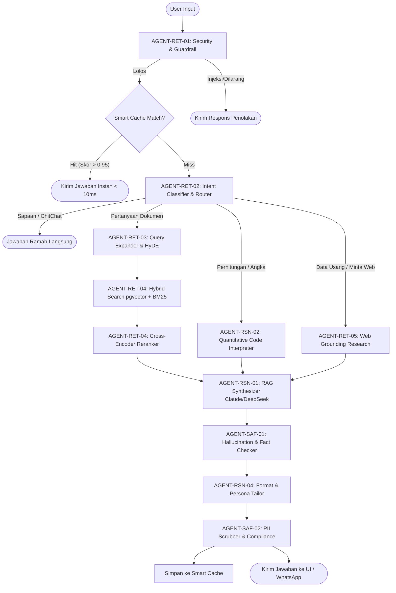
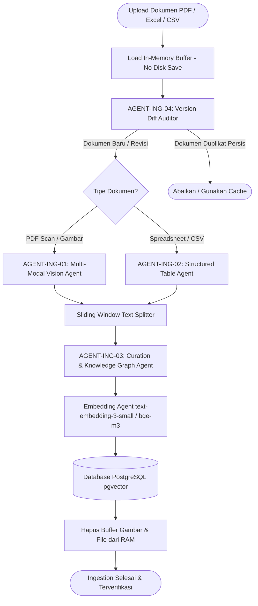

# 🏛️ Cetak Biru Arsitektur Multi-Agent BrilianAI (Enterprise Autonomous Knowledge Platform)

Dokumen ini adalah spesifikasi arsitektur komprehensif untuk mentransformasi sistem **BrilianAI** dari sekadar *RAG chatbot* standar menjadi **Platform Kecerdasan Dokumen & Otomasi Pengetahuan Multi-Agent Kelas Enterprise**.

Dokumen ini disusun sebagai panduan teknis (*blueprint*) agar proses perancangan ulang (*re-coding*) dapat dilakukan secara modular, bersih (*clean architecture*), mudah diuji (*testable*), dan siap untuk lingkungan produksi skala besar (baik mode **Cloud API**, **Dedicated GPU**, maupun **VPS CPU Standar**).

---

## 📑 DAFTAR ISI
1. [Visi & Filosofi Desain Sistem](#1-visi--filosofi-desain-sistem)
2. [Matriks Taksonomi 18 Specialized Agents](#2-matriks-taksonomi-18-specialized-agents)
3. [Spesifikasi Rinci Setiap Agent (Pilar 1 - 5)](#3-spesifikasi-rinci-setiap-agent)
   - [Pilar 1: Ingestion & Document Intelligence](#pilar-1-ingestion--document-intelligence-data-in)
   - [Pilar 2: Retrieval, Security & Grounding](#pilar-2-retrieval-security--grounding-search-engine)
   - [Pilar 3: Reasoning, Synthesis & Computation](#pilar-3-reasoning-synthesis--computation-cognitive-engine)
   - [Pilar 4: Quality Gate, Safety & Compliance](#pilar-4-quality-gate-safety--compliance-output-guard)
   - [Pilar 5: Action, Omnichannel & Continuous Learning](#pilar-5-action-omnichannel--continuous-learning)
4. [Diagram Alur Orkestrasi & State Machine](#4-diagram-alur-orkestrasi--state-machine)
5. [Desain Rekayasa Kode Bersih (Clean Code Architecture)](#5-desain-rekayasa-kode-bersih-clean-code-architecture)
6. [Skema Database & State Context Per Session](#6-skema-database--state-context-per-session)
7. [Roadmap Implementasi Bertahap (Sprint Execution)](#7-roadmap-implementasi-bertahap-sprint-execution)

---

## 1. Visi & Filosofi Desain Sistem

### 1.1 Masalah pada Sistem RAG Tradisional
* **Single-Agent Overload:** Menyerahkan pembersihan teks, penalaran, kalkulasi angka, sitasi dokumen, dan pemformatan teks ke satu model LLM dalam satu *prompt* panjang sering menyebabkan halusinasi, kesalahan logika matematika, atau pelanggaran format instruksi pengguna.
* **Kerapuhan Data Tabular & Angka:** Model bahasa murni tidak andal dalam menjumlahkan atau menghitung persentase dari tabel keuangan tebal (misal: Laporan Tahunan ratusan halaman).
* **Blindspot Informasi Lampau:** Dokumen internal tahun 2018 tidak bisa menjawab pertanyaan kondisi tahun 2026 tanpa adanya jembatan data publik terkini (*Grounding*).
* **Kebutuhan Format Khusus Saluran (Omnichannel):** Respon untuk antarmuka web, pesan WhatsApp mobile, atau laporan ekspor PDF memiliki karakteristik gaya dan pembatasan yang berbeda.

### 1.2 Prinsip Inti BrilianAI Multi-Agent
1. **Single Responsibility Principle (SRP):** Setiap agent memiliki satu tugas spesifik dan dapat diuji secara terisolasi (*unit-testable*).
2. **Kedaulatan & Keamanan Data (Zero-Disk Storage):** Dokumen sensitif diproses *100% in-memory* (Node.js Buffer) dan langsung dihancurkan setelah embedding/curation tersimpan di pgvector.
3. **Strict Citation & Zero-Hallucination:** Kutipan fakta, nama orang, nomor pasal, dan klausul dokumen resmi **tidak boleh diubah urutan katanya**. Jika informasi tidak ada di dokumen internal, sistem wajib menyatakan data tidak ditemukan (kecuali izin web grounding diaktifkan).
4. **Multi-Tier Model Fallback:** Sistem mengutamakan model berbiaya hemat/kecepatan tinggi, dan otomatis beralih ke model nalar tinggi saat menghadapi pertanyaan kompleks (DeepSeek-V3 / Claude 3.5 Sonnet / GPT-4o).

---

## 2. Matriks Taksonomi 18 Specialized Agents

Berikut ringkasan 18 agent yang dikelompokkan ke dalam 5 pilar strategis:

| ID | Nama Agent | Pilar / Layer | Rekomendasi Model (Cloud / Local) | Output Kunci |
| :--- | :--- | :--- | :--- | :--- |
| **ING-01** | **Multi-Modal Document Vision Agent** | Ingestion | Gemini 2.0 Flash / Qwen2.5-VL 7B | Markdown teks bersih + deteksi layout |
| **ING-02** | **Structured Table & Excel Agent** | Ingestion | GPT-4o-mini / Qwen2.5-Coder 7B | Markdown Table terstruktur / JSON Matrix |
| **ING-03** | **Data Curation & Knowledge Graph Agent** | Ingestion | GPT-4o-mini / Llama 3.2 3B | Insight kurasi, Entity (NER), Tags, Kategori |
| **ING-04** | **Document Sync & Version Diff Auditor** | Ingestion | Rule-based Node.js + SHA256 Hash | Changelog versi dokumen & eviksi chunk usang |
| **RET-01** | **Security Guardrail & Injection Firewall** | Retrieval | GPT-4o-mini / Gemini Flash Lite | Decision JSON (Allow/Block, Reason, PII Mask) |
| **RET-02** | **Query Intent Classifier & Router** | Retrieval | GPT-4o-mini / Gemma 2 2B | Rute Pipeline (Chitchat, RAG, Math, Web, Action) |
| **RET-03** | **Semantic Query Expander & HyDE Agent** | Retrieval | GPT-4o-mini / Llama 3.2 3B | Query vektor optimal + sinonim korporat |
| **RET-04** | **Hybrid Search & Cross-Encoder Reranker** | Retrieval | BGE-Reranker-Large / Cohere Rerank | Top-K Chunks terurut relevansi tertinggi |
| **RET-05** | **Web Grounding & Real-Time Research** | Retrieval | Tavily API / DuckDuckGo + Gemini Flash | Snippet berita & data publik terverifikasi |
| **RSN-01** | **RAG Synthesizer & Verbatim Citation** | Reasoning | Claude 3.5 Sonnet / DeepSeek-V3 / Qwen 7B | Draf jawaban komprehensif + sitasi halaman |
| **RSN-02** | **Quantitative Analyst & Code Interpreter** | Reasoning | Isolated JS VM / Python Sandbox + GPT-4o | Hasil kalkulasi presisi 100% tanpa halusinasi |
| **RSN-03** | **Deep Multi-Document Comparison Agent** | Reasoning | DeepSeek-R1 / Claude 3.5 Sonnet | Matriks komparasi & analisis tren silang |
| **RSN-04** | **Persona, Format & Channel Tailor** | Reasoning | GPT-4o-mini / Gemma 2 2B | Format presisi (jumlah poin, WA markdown) |
| **SAF-01** | **Fact-Checking & Hallucination Auditor** | Safety Gate | GPT-4o-mini / Qwen2.5 7B | Skor Faithfulness & koreksi klaim palsu |
| **SAF-02** | **Enterprise Compliance & PII Scrubber** | Safety Gate | Pattern Matcher + GPT-4o-mini | Masking data sensitif & audit log keamanan |
| **ACT-01** | **Enterprise Action & Workflow Agent** | Action | Function Calling Tool Agent | Eksekusi API, pembuatan PDF/Excel, Tiket |
| **ACT-02** | **Omnichannel Gateway Agent** | Channels | WhatsApp Cloud API / Baileys Gateway | Pesan adaptif WhatsApp, chunking & media |
| **ACT-03** | **Smart Cache & Knowledge Gap Agent** | Learning | PostgreSQL HNSW + GPT-4o-mini | Cache warm-up & laporan topik belum terjawab |

---

## 3. Spesifikasi Rinci Setiap Agent

### Pilar 1: Ingestion & Document Intelligence (Data In)

#### 1. Multi-Modal Document Vision Agent (`AGENT-ING-01`)
* **Peran:** Membaca setiap halaman dokumen (PDF scan, dokumen presentasi slide, diagram alur, gambar dokumen lama) dengan pemahaman visual spasial.
* **Fungsi Utama:**
  - Mengonversi halaman PDF menjadi representasi visual (*high-res in-memory image*).
  - Mengekstrak teks dengan mempertahankan hierarki judul, sub-judul, dan catatan kaki.
  - Membuang noise berulang (nomor halaman, header kop surat, watermark "CONFIDENTIAL").
* **Trigger:** Event upload dokumen baru di antarmuka Web atau API upload batch.
* **Input:** `Buffer` (PNG/JPEG per halaman) + `pageNumber: number`.
* **Output:** `rawPageMarkdown: string` (Markdown bersih dengan metadata posisi).
* **Model Rekomendasi:** Google Gemini 2.0 Flash / Qwen2.5-VL 7B (Ollama).

#### 2. Structured Table & Excel Agent (`AGENT-ING-02`)
* **Peran:** Spesialis pemrosesan dokumen berbasis tabular: spreadsheet (XLSX, CSV) dan tabel finansial multi-kolom di dalam dokumen PDF.
* **Fungsi Utama:**
  - Membaca baris dan kolom tanpa memecah relasi antara *header* kolom dengan nilai sel data.
  - Mengonversi tabel kompleks menjadi format Markdown teratur dan representasi JSON terstruktur.
  - Menyematkan ringkasan semantik pada setiap tabel agar mudah ditemukan oleh pencarian vektor (contoh: *"Tabel Rasio Keuangan Triwulan IV 2023 - Halaman 45"*).
* **Input:** `TableChunkBuffer` atau array `string[][]`.
* **Output:** `StructuredTableResult { markdown: string; jsonTable: object; tableSummary: string }`.
* **Model Rekomendasi:** OpenAI GPT-4o-mini / Qwen2.5-Coder 7B.

#### 3. Data Curation & Knowledge Graph Agent (`AGENT-ING-03`)
* **Peran:** Mentransformasi teks mentah (*raw chunks*) menjadi *Insight Kurasi* bernilai tinggi, mengekstraksi entitas kunci, dan memetakan taksonomi.
* **Fungsi Utama:**
  - Menilai tingkat kepentingan dokumen (`importance: 'high' | 'medium' | 'low'`).
  - Menetapkan kategori tematik (contoh: `finance`, `governance`, `sop`, `sdm`, `legal`).
  - Mengekstrak Named Entities (NER): nama divisi, kode proyek, nomor regulasi, tanggal berlaku.
  - Menghasilkan judul spesifik dan padat untuk setiap potongan informasi penting.
* **Input:** `RawChunk { content: string; pageStart: number; pageEnd: number }`.
* **Output:** `CuratedInsightPayload` (tersimpan di tabel `curated_insights`).
* **Model Rekomendasi:** OpenAI GPT-4o-mini / Llama 3.2 3B.

#### 4. Document Sync & Version Diff Auditor Agent (`AGENT-ING-04`)
* **Peran:** Mengelola siklus hidup dokumen, sinkronisasi perubahan dari Google Drive / folder bersama, dan pencegahan duplikasi data.
* **Fungsi Utama:**
  - Menghitung cryptographic hash (SHA-256) dokumen yang diunggah.
  - Mendeteksi apakah dokumen yang diunggah adalah revisi terbaru dari dokumen sebelumnya (contoh: *"SOP Cuti 2023.pdf"* digantikan oleh *"SOP Cuti 2024.pdf"*).
  - Menandai (*archive/deprecate*) chunk dokumen versi usang agar tidak lagi ditarik oleh pencarian RAG aktif.
* **Input:** `FileMetadata { filename: string; sha256: string; externalSyncId?: string }`.
* **Output:** `SyncActionPlan { isNew: boolean; supersededBatchId?: string; action: 'insert' | 'replace' | 'skip' }`.
* **Model Rekomendasi:** Rule-based TypeScript + PostgreSQL transaction.

---

### Pilar 2: Retrieval, Security & Grounding (Search Engine)

#### 5. Security Guardrail & Injection Firewall Agent (`AGENT-RET-01`)
* **Peran:** Penjaga pintu gerbang pertama sebelum kueri pengguna masuk ke sistem inti.
* **Fungsi Utama:**
  - Mencegah serangan *Prompt Injection*, *Jailbreak*, pembocoran instruksi sistem (*System Prompt Leak*), dan *Denial-of-Service* teks panjang.
  - Memeriksa otorisasi RBAC pengguna: memastikan user biasa tidak menanyakan dokumen rahasia milik divisi lain (`is_active_knowledge` & tenant access).
  - Melakukan *anonymization / PII scrubbing* pada kueri sebelum diteruskan ke model AI publik luar.
* **Input:** `UserQueryPayload { rawQuery: string; userId: string; userRole: string }`.
* **Output:** `GuardrailDecision { isAllowed: boolean; blockedReason?: string; sanitizedQuery: string }`.
* **Model Rekomendasi:** OpenAI GPT-4o-mini / Gemini 2.0 Flash Lite (Latency < 350ms).

#### 6. Query Intent Classifier & Dynamic Router Agent (`AGENT-RET-02`)
* **Peran:** Menganalisis maksud kueri pengguna dan mengarahkan lalu lintas data ke pipeline yang paling efisien.
* **Kategori Rute:**
  1. `CHITCHAT_OR_GREETING` ➔ Langsung dijawab oleh Router tanpa membebani database pgvector.
  2. `FACTUAL_SINGLE_DOC` ➔ Pipeline RAG Standar (cepat & hemat token).
  3. `QUANTITATIVE_CALCULATION` ➔ Pipeline Code Interpreter / Math Agent.
  4. `DEEP_MULTI_DOC_RESEARCH` ➔ Pipeline Analisis Multi-Dokumen Komprehensif.
  5. `OUTDATED_OR_WEB_SEARCH` ➔ Pipeline Web Grounding.
  6. `ACTION_WORKFLOW` ➔ Pipeline Eksekusi Tool (Generate file, kirim email).
* **Input:** `SanitizedQuery: string` + `ConversationHistory: Message[]`.
* **Output:** `RouterPlan { intent: string; confidence: number; targetPipeline: string; optimizedKeywords: string[] }`.
* **Model Rekomendasi:** OpenAI GPT-4o-mini / Gemma 2 2B.

#### 7. Semantic Query Expander & HyDE Agent (`AGENT-RET-03`)
* **Peran:** Meningkatkan akurasi pencarian vektor untuk pertanyaan pengguna yang ambigu, terlalu singkat, atau menggunakan istilah gaul/akronim lokal.
* **Fungsi Utama:**
  - Mengembangkan singkatan internal perusahaan (contoh: "KUR" ➔ "Kredit Usaha Rakyat", "SLA" ➔ "Service Level Agreement").
  - Menghasilkan *Hypothetical Document Embeddings (HyDE)*: membuat draf paragraf jawaban hipotetis untuk dijadikan vektor pencarian, bukan hanya meng-embed pertanyaan mentah.
  - Menghasilkan kueri multibahasa (mencocokkan istilah Inggris di dokumen dengan kueri bahasa Indonesia).
* **Input:** `RouterPlan.optimizedKeywords` + `SanitizedQuery`.
* **Output:** `ExpandedQuerySet { primaryVectorQuery: string; fullTextTokens: string[]; hydeSnippet?: string }`.
* **Model Rekomendasi:** OpenAI GPT-4o-mini / Llama 3.2 3B.

#### 8. Hybrid Search & Cross-Encoder Reranker Agent (`AGENT-RET-04`)
* **Peran:** Mesin pencari hybrid yang menggabungkan kekuatan pencarian semantik (vektor) dan pencarian leksikal (keyword exact match), lalu mengurutkannya dengan model perankat (*reranker*).
* **Fungsi Utama:**
  - **Dense Retrieval:** Pencarian kemiripan kosinus via pgvector HNSW index (dimensi 1024 / bge-m3 / text-embedding-3-small).
  - **Sparse Retrieval:** Pencarian kata kunci persis via PostgreSQL Full-Text Search (`tsvector` / BM25).
  - **Reciprocal Rank Fusion (RRF):** Menggabungkan skor dense dan sparse.
  - **Cross-Encoder Reranking:** Memilih 20 kandidat teratas dan menggunakan model reranker untuk menyaring menjadi Top 5-7 chunk paling relevan secara presisi tinggi.
* **Input:** `ExpandedQuerySet` + `documentScopeFilter?: string[]`.
* **Output:** `RankedChunk[] { chunkId: string; content: string; filename: string; pageRange: string; rerankScore: number }`.
* **Model Rekomendasi:** BGE-Reranker-Large (Ollama) / Cohere Rerank API.

#### 9. Web Grounding & Real-Time Research Agent (`AGENT-RET-05`)
* **Peran:** Menyediakan jembatan data publik terkini apabila dokumen internal sudah kadaluarsa atau pengguna secara eksplisit meminta perbandingan data eksternal.
* **Fungsi Utama:**
  - Mendeteksi kapan kueri menanyakan tahun/waktu yang melampaui masa dokumen internal (contoh: kueri meminta data 2026 dari dokumen tahun 2018).
  - Melakukan pencarian web terkurasi via search engine API resmi (Tavily / DuckDuckGo / SearXNG).
  - Mengekstrak 3-5 sumber web resmi dan menyusun ringkasan komparatif antara data dokumen internal vs data publik terkini.
* **Input:** `Query: string` + `OutdatedContextNotice: string`.
* **Output:** `WebGroundingContext { sources: WebSource[]; summary: string; fetchedAt: string }`.
* **Model Rekomendasi:** Tavily API / DuckDuckGo + Google Gemini 2.0 Flash.

---

### Pilar 3: Reasoning, Synthesis & Computation (Cognitive Engine)

#### 10. RAG Synthesizer & Verbatim Citation Agent (`AGENT-RSN-01`)
* **Peran:** Otak nalar utama sistem yang menyusun respon akhir berdasarkan potongan dokumen yang terverifikasi.
* **Aturan Mutlak:**
  - **Strict Citation:** Setiap fakta penting wajib diberi sitasi jelas berupa `[NamaDokumen.pdf - Halaman X-Y]`.
  - **Verbatim Text Preservation:** Pada teks pasal, regulasi, klausul hukum, atau definisi teknis, susunan kata dilarang diubah agar tidak terjadi pergeseran tafsir.
  - **Jujur Tanpa Kompromi:** Jika bukti dokumen tidak mencukupi, agen wajib menjawab bahwa data tidak tercantum di dokumen.
* **Input:** `RankedChunks[]` + `SanitizedQuery` + `FormattingInstruction`.
* **Output:** `SynthesizedDraft { text: string; citations: CitationMeta[]; isDefinitive: boolean }`.
* **Model Rekomendasi:** Anthropic Claude 3.5 Sonnet / DeepSeek-V3 / Qwen2.5 7B.

#### 11. Quantitative Analyst & Code Interpreter Agent (`AGENT-RSN-02`)
* **Peran:** Menyelesaikan pertanyaan yang melibatkan angka, perhitungan matematis, rasio keuangan, atau agregasi statistik dari data dokumen.
* **Fungsi Utama:**
  - Mencegah halusinasi kalkulasi matematika pada model LLM.
  - Menulis kode komputasi (JavaScript / Python sandboxed) untuk menghitung angka secara eksak (contoh: persentase pertumbuhan, delta laba, margin rasio, rata-rata tertimbang).
  - Mengembalikan hasil kalkulasi dengan rumus yang transparan dan dapat diaudit.
* **Input:** `NumericTableChunks[]` + `MathQuery: string`.
* **Output:** `CalculationResult { computedValue: number | string; formulaUsed: string; explanation: string }`.
* **Model Rekomendasi:** Isolated Node VM (sandboxed) + OpenAI GPT-4o / DeepSeek-V3.

#### 12. Deep Multi-Document Comparison Agent (`AGENT-RSN-03`)
* **Peran:** Melakukan analisis lintas dokumen yang memerlukan pembacaan menyeluruh atas beberapa laporan, SOP, atau kebijakan berbeda.
* **Fungsi Utama:**
  - Memecah pertanyaan kompleks menjadi sub-pertanyaan (*deconstructed sub-queries*).
  - Mengambil data dari Dokumen A dan Dokumen B secara paralel.
  - Menyusun matriks komparasi (contoh: perbedaan pasal, matriks perbandingan performa tahun ke tahun, atau analisis SWOT komparatif).
* **Input:** `MultiDocQuery` + `TargetDocumentIds: string[]`.
* **Output:** `ComparativeAnalysisReport { matrixTable: string; deepNarrative: string; differences: string[] }`.
* **Model Rekomendasi:** DeepSeek-R1 / Anthropic Claude 3.5 Sonnet.

#### 13. Persona, Format & Channel Tailor Agent (`AGENT-RSN-04`)
* **Peran:** Memastikan bahwa jawaban yang dihasilkan mematuhi aturan format pengguna (sesuai spesifikasi `Pertanyaan.md`) dan disesuaikan dengan saluran komunikasi (*channel*).
* **Fungsi Utama:**
  - **Deteksi Format Ketat:** Memastikan jumlah poin persis sesuai permintaan (misal: "buat 4 poin" ➔ wajib tepat 4 poin).
  - **Deteksi Gaya:** Menyesuaikan gaya bahasa (singkat/padat, ramah awam, atau teknis mendalam).
  - **Channel Formatting:** Mengonversi tabel Markdown menjadi format teks rapi untuk WhatsApp/Telegram, atau menjaga tabel Markdown murni untuk Web UI.
* **Input:** `SynthesizedDraft.text` + `UserFormattingInstruction` + `Channel: 'web' | 'whatsapp' | 'email'`.
* **Output:** `FormattedFinalAnswer: string`.
* **Model Rekomendasi:** OpenAI GPT-4o-mini / Gemma 2 2B / Rule-based parser.

---

### Pilar 4: Quality Gate, Safety & Compliance (Output Guard)

#### 14. Fact-Checking & Hallucination Auditor Agent (`AGENT-SAF-01`)
* **Peran:** Validator independen yang menguji apakah draf jawaban yang dibuat benar-benar didukung (*entailed*) oleh potongan dokumen sumber.
* **Fungsi Utama:**
  - Melakukan uji *Natural Language Inference (NLI)* antara setiap kalimat pada draf jawaban dan referensi chunk dokumen.
  - Memberikan skor kepatuhan fakta (*Faithfulness Score* 0.0 - 1.0).
  - Jika ditemukan klaim yang tidak tercatat di dokumen, kalimat tersebut dihapus atau diganti dengan penegasan bahwa data tidak tertera.
* **Input:** `SynthesizedDraft.text` + `RankedChunks[]`.
* **Output:** `AuditDecision { passed: boolean; faithfulnessScore: number; correctedText: string; strippedClaims: string[] }`.
* **Model Rekomendasi:** OpenAI GPT-4o-mini / Qwen2.5 7B.

#### 15. Enterprise Compliance & PII Scrubber Agent (`AGENT-SAF-02`)
* **Peran:** Memastikan output yang keluar dari sistem tidak melanggar kepatuhan data korporat (*Data Loss Prevention / DLP*).
* **Fungsi Utama:**
  - Melakukan sensor otomatis (*masking*) pada data sensitif: Nomor Induk Kependudukan (NIK), nomor kartu kredit, nomor rekening, kata sandi, atau nomor kontak pribadi.
  - Memastikan tidak ada token rahasia sistem atau prompt internal yang bocor ke pengguna akhir.
  - Mencatat log audit keamanan secara terenkripsi ke tabel `audit_logs`.
* **Input:** `AuditedText: string` + `SessionContext`.
* **Output:** `CleanVerifiedResponse: string`.
* **Model Rekomendasi:** Fast Regex Engine + GPT-4o-mini Safety Fallback.

---

### Pilar 5: Action, Omnichannel & Continuous Learning

#### 16. Enterprise Action & Workflow Agent (`AGENT-ACT-01`)
* **Peran:** Mengubah BrilianAI dari asisten informatif menjadi asisten operasional yang mampu mengeksekusi tugas.
* **Fungsi Utama:**
  - Mengonversi hasil ringkasan dokumen menjadi file laporan siap unduh (PDF report atau spreadsheet Excel).
  - Memicu Webhook ke sistem internal perusahaan (misal: CRM, ERP, atau tiket bantuan IT).
  - Mengirim notifikasi email ringkasan ke manajer terkait.
* **Input:** `ToolCallRequest { action: string; parameters: Record<string, any> }`.
* **Output:** `ActionResult { status: 'success' | 'failed'; artifactUrl?: string; message: string }`.
* **Model Rekomendasi:** Tool/Function Calling Agent (OpenAI GPT-4o / DeepSeek-V3).

#### 17. Omnichannel Gateway Agent (`AGENT-ACT-02`)
* **Peran:** Menyediakan akses interaktif ke BrilianAI melalui aplikasi perpesanan instan (khususnya WhatsApp & Telegram).
* **Fungsi Utama:**
  - Menangani webhook masuk dari WhatsApp Cloud API / Baileys.
  - Menghitung batasan karakter pesan WhatsApp dan memecah pesan panjang menjadi chunk berurutan yang nyaman dibaca di smartphone.
  - Mengonversi audio *Voice Note* pengguna menjadi teks via Whisper API sebelum diproses oleh pipeline RAG.
  - Mengirim tombol interaktif / quick replies untuk pertanyaan lanjutan (*follow-up suggestions*).
* **Input:** `WhatsAppInboundWebhookPayload` / `VoiceNoteBuffer`.
* **Output:** `WhatsAppOutboundMessage[]`.
* **Model Rekomendasi:** OpenAI Whisper (Speech-to-Text) + Gateway Node.js Worker.

#### 18. Smart Cache & Knowledge Gap Agent (`AGENT-ACT-03`)
* **Peran:** Mesin pembelajaran mandiri yang mengoptimalkan kecepatan respons dan mendeteksi kekurangan data pengetahuan perusahaan.
* **Fungsi Utama:**
  - Menyimpan jawaban pertanyaan populer ke dalam `chat_response_cache` (Layer 1: Exact Hash, Layer 2: Semantic Cosine Match > 0.95) sehingga kueri berulang dijawab instan (<10ms) tanpa biaya token API atau beban CPU.
  - Menganalisis log kueri dengan hasil "Data tidak ditemukan" secara agregat.
  - Membuat laporan mingguan untuk Superadmin: *"Topik apa saja yang paling banyak ditanyakan karyawan tetapi dokumennya belum ada di BrilianAI"*.
* **Input:** `CompletedInteractionLog[]`.
* **Output:** `KnowledgeGapReport { missingTopics: string[]; searchFrequency: number; recommendedDocUploads: string[] }`.
* **Model Rekomendasi:** Background Cron Worker + GPT-4o-mini Analyzer.

---

## 4. Diagram Alur Orkestrasi & State Machine

Sistem menggunakan pola **Hierarchical Supervisor Pattern** dengan state machine terarah (*Directed Acyclic Graph*).

### 4.1 Diagram Alur Chat & Inquiry Pipeline



### 4.2 Diagram Alur Ingestion Pipeline



---

## 5. Desain Rekayasa Kode Bersih (Clean Code Architecture)

Untuk mempermudah *re-coding* sistem secara keseluruhan dan rapih, struktur direktori disarankan ditata dengan prinsip pemisahan tanggung jawab domain (*Domain-Driven Design*):

### 5.1 Rekomendasi Struktur Folder

```
src/
├── app/                        # Next.js App Router (UI & API Routes)
│   ├── api/
│   │   ├── chat/route.ts       # Endpoint utama chat (streaming SSE)
│   │   ├── documents/          # Upload & listing dokumen
│   │   └── webhooks/whatsapp/  # Webhook pesan WhatsApp
├── lib/
│   ├── agents/                 # PUSAT SELURUH SPECIALIZED AGENTS
│   │   ├── core/
│   │   │   ├── BaseAgent.ts    # Interface standar & abstract class
│   │   │   ├── AgentRegistry.ts# Katalog instansiasi seluruh agent
│   │   │   └── AgentContext.ts # State context yang dibawa antar-agent
│   │   ├── ingestion/
│   │   │   ├── VisionIngestionAgent.ts      # AGENT-ING-01
│   │   │   ├── StructuredTableAgent.ts      # AGENT-ING-02
│   │   │   ├── KnowledgeCurationAgent.ts    # AGENT-ING-03
│   │   │   └── VersionDiffAuditorAgent.ts   # AGENT-ING-04
│   │   ├── retrieval/
│   │   │   ├── GuardrailAgent.ts            # AGENT-RET-01
│   │   │   ├── QueryRouterAgent.ts          # AGENT-RET-02
│   │   │   ├── QueryExpanderAgent.ts        # AGENT-RET-03
│   │   │   ├── HybridSearchAgent.ts         # AGENT-RET-04
│   │   │   └── WebGroundingAgent.ts         # AGENT-RET-05
│   │   ├── reasoning/
│   │   │   ├── RagSynthesizerAgent.ts       # AGENT-RSN-01
│   │   │   ├── QuantitativeAnalystAgent.ts  # AGENT-RSN-02
│   │   │   ├── DeepResearchAgent.ts         # AGENT-RSN-03
│   │   │   └── FormatTailorAgent.ts         # AGENT-RSN-04
│   │   ├── safety/
│   │   │   ├── FactCheckingAgent.ts         # AGENT-SAF-01
│   │   │   └── CompliancePiiAgent.ts        # AGENT-SAF-02
│   │   └── action/
│   │       ├── EnterpriseActionAgent.ts     # AGENT-ACT-01
│   │       ├── OmnichannelGatewayAgent.ts   # AGENT-ACT-02
│   │       └── SmartCacheLearningAgent.ts   # AGENT-ACT-03
│   ├── orchestrator/           # Multi-Agent Workflow Engine
│   │   ├── ChatPipelineOrchestrator.ts
│   │   ├── IngestionOrchestrator.ts
│   │   └── StateGraph.ts
│   ├── db/                     # Koneksi database & pgvector queries
│   │   ├── dbClient.ts
│   │   ├── vectorStore.ts
│   │   └── cacheStore.ts
│   └── queue/                  # BullMQ Background Job Worker
│       ├── ingestionQueue.ts
│       └── researchQueue.ts
```

### 5.2 Standarisasi Interface TypeScript `BaseAgent`

Semua agent wajib mengimplementasikan interface standar berikut untuk menjamin modularitas, kemudahan pengujian (*mocking*), dan *tracing*:

```typescript
// lib/agents/core/BaseAgent.ts

export interface AgentMetadata {
  id: string;             // Contoh: "AGENT-RET-01"
  name: string;           // "Security Guardrail Agent"
  version: string;        // "2.0.0"
  timeoutMs: number;      // Batas waktu eksekusi sebelum fallback (ms)
}

export interface AgentContext {
  sessionId: string;
  userId: string;
  userRole: string;
  channel: 'web' | 'whatsapp' | 'api';
  traceId: string;
  metadata: Record<string, any>;
}

export interface AgentResult<TOutput> {
  success: boolean;
  data: TOutput;
  executionTimeMs: number;
  tokensUsed?: { input: number; output: number };
  fallbackTriggered?: boolean;
  error?: string;
}

export abstract class BaseAgent<TInput, TOutput> {
  abstract readonly metadata: AgentMetadata;

  /**
   * Menjalankan tugas utama agent dengan proteksi timeout & error handling
   */
  async execute(input: TInput, context: AgentContext): Promise<AgentResult<TOutput>> {
    const startTime = Date.now();
    try {
      const data = await Promise.race([
        this.run(input, context),
        this.createTimeoutPromise(this.metadata.timeoutMs),
      ]);
      return {
        success: true,
        data,
        executionTimeMs: Date.now() - startTime,
      };
    } catch (err: any) {
      console.warn(`[Agent ${this.metadata.id}] Eksekusi gagal:`, err.message);
      const fallbackData = await this.fallback(input, context, err);
      return {
        success: false,
        data: fallbackData,
        executionTimeMs: Date.now() - startTime,
        fallbackTriggered: true,
        error: err.message,
      };
    }
  }

  protected abstract run(input: TInput, context: AgentContext): Promise<TOutput>;
  protected abstract fallback(input: TInput, context: AgentContext, error: Error): Promise<TOutput>;

  private createTimeoutPromise(ms: number): Promise<never> {
    return new Promise((_, reject) =>
      setTimeout(() => reject(new Error(`Timeout agent melebihi ${ms}ms`)), ms)
    );
  }
}
```

---

## 6. Skema Database & State Context Per Session

Untuk mendukung orkestrasi multi-agent yang dapat diaudit dan memiliki pelacakan jejak (*observability*), skema database dilengkapi tabel audit trace berikut:

```sql
-- db/migrations/010_create_agent_execution_traces.sql

CREATE TABLE IF NOT EXISTS agent_execution_traces (
    id BIGSERIAL PRIMARY KEY,
    trace_id UUID NOT NULL,
    session_id UUID REFERENCES chat_sessions(id) ON DELETE CASCADE,
    agent_id VARCHAR(50) NOT NULL,
    agent_name VARCHAR(100) NOT NULL,
    input_payload JSONB,
    output_payload JSONB,
    execution_time_ms INT NOT NULL,
    fallback_triggered BOOLEAN DEFAULT FALSE,
    error_message TEXT,
    created_at TIMESTAMPTZ DEFAULT NOW()
);

CREATE INDEX IF NOT EXISTS idx_agent_traces_trace_id ON agent_execution_traces (trace_id);
CREATE INDEX IF NOT EXISTS idx_agent_traces_session_id ON agent_execution_traces (session_id);
CREATE INDEX IF NOT EXISTS idx_agent_traces_agent_id ON agent_execution_traces (agent_id);
```

---

## 7. Roadmap Implementasi Bertahap (Sprint Execution)

Agar proses *re-coding* berjalan rapih tanpa mengganggu sistem yang sedang berjalan, implementasi dibagi menjadi 4 tahap logis:

```
[ Fase 1: Fondasi Modular ]  ──► [ Fase 2: Kualitas & Grounding ]
        │                                     │
        ▼                                     ▼
[ Fase 3: Komputasi & Analisis ] ──► [ Fase 4: Omnichannel & Learning ]
```

### 🔹 Fase 1: Fondasi Modular & Inti RAG (Sprint 1)
* Mengimplementasikan `BaseAgent` dan folder `lib/agents/`.
* Memindahkan kode yang sudah ada ke dalam modul agent:
  - `VisionIngestionAgent` (`AGENT-ING-01`)
  - `GuardrailAgent` (`AGENT-RET-01`)
  - `QueryRouterAgent` (`AGENT-RET-02`)
  - `RagSynthesizerAgent` (`AGENT-RSN-01`)
  - `FormatTailorAgent` (`AGENT-RSN-04` - implementasi aturan `Pertanyaan.md`).
* Menyusun `ChatPipelineOrchestrator` awal untuk menghubungkan agent di atas.

### 🔹 Fase 2: Kualitas Retrieval, Safety & Grounding (Sprint 2)
* Mengembangkan `HybridSearchAgent` (`AGENT-RET-04`) menggabungkan pgvector + BM25 reranking.
* Mengaktifkan `WebGroundingAgent` (`AGENT-RET-05`) untuk pertanyaan bertahun baru atau data eksternal.
* Memasang `FactCheckingAgent` (`AGENT-SAF-01`) dan `CompliancePiiAgent` (`AGENT-SAF-02`) sebagai gerbang output kualitas.
* Mengintegrasikan tabel audit `agent_execution_traces`.

### 🔹 Fase 3: Komputasi Angka & Analisis Lintas Dokumen (Sprint 3)
* Mengembangkan `StructuredTableAgent` (`AGENT-ING-02`) untuk file XLSX/CSV dan tabel finansial tebal.
* Membangun `QuantitativeAnalystAgent` (`AGENT-RSN-02`) dengan sandboxed JavaScript engine untuk menghitung metrik matematika secara eksak.
* Membangun `DeepResearchAgent` (`AGENT-RSN-03`) untuk perbandingan multi-dokumen.

### 🔹 Fase 4: Omnichannel WhatsApp & Pembelajaran Mandiri (Sprint 4)
* Mengintegrasikan `OmnichannelGatewayAgent` (`AGENT-ACT-02`) untuk gateway WhatsApp Cloud API / bot WhatsApp.
* Mengembangkan `SmartCacheLearningAgent` (`AGENT-ACT-03`) untuk auto-warm cache dan pelaporan *Knowledge Gap* mingguan.
* Mengimplementasikan `EnterpriseActionAgent` (`AGENT-ACT-01`) untuk ekspor laporan PDF/Excel langsung dari sesi chat.

---

> Dokumen ini siap digunakan sebagai acuan baku teknis bagi developer / coding agent dalam melakukan rekonstruksi arsitektur sistem BrilianAI secara menyeluruh.
